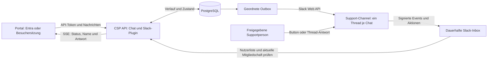

# Slack-Support im Portal

`@kieksme/csp-plugin-slack` ergänzt den Chat um gespeicherte Gespräche und menschliche Übernahme in einem Slack-Channel. Es verwendet dieselbe Gesprächslogik wie [Teams](teams-support.md). Die Slack-Verbindung ist **noch ungetestet**: automatisierte Prüfungen verwenden synthetische Slack-Antworten; Installation und Zustellung in einem echten Workspace müssen vor dem Produktivbetrieb abgenommen werden.

## Ablauf

Pro Portal-Gespräch entsteht ein Channel-Thread mit Gesprächs-ID sowie einem verifizierten Portal-Namen oder einem pseudonymen Besuchernamen. Nutzerfragen und abgeschlossene KI-Antworten erscheinen im Thread. **Übernehmen** reserviert das Gespräch atomar für eine berechtigte Person, stoppt die laufende KI-Ausgabe und zeigt den aus Slack abgerufenen Namen im Portal.

**Jede neue Textantwort der zuständigen Person in diesem Thread wird eine Kundenantwort.** Andere Personen dürfen dort intern diskutieren; die zuständige Person muss dafür einen anderen Ort verwenden. Antworten von vor der Übernahme, Bot-Nachrichten, Bearbeitungen, Löschungen und Anhänge werden nicht synchronisiert. **An Bot zurückgeben** erlaubt KI-Antworten auf die nächste Portal-Frage; **Abschließen** beendet das Gespräch. Nur die zuständige Person darf zurückgeben oder abschließen. Es gibt keinen automatischen Wechsel.



## Installation

Nach Veröffentlichung des neuen Pakets im eigenständigen Kundenrepo:

```sh
pnpm dlx @kieksme/csp-cli plugin add @kieksme/csp-plugin-slack
```

Das Chat-Plugin muss installiert sein. `chatSupport` erfordert genau einen Supporttransport; Teams und Slack können nicht gemeinsam denselben Gesprächsbestand verwalten. Bestehende Teams-Gespräche werden nicht automatisch nach Slack migriert. Beim Wechsel eine eigene neue Datenbank verwenden und alte Gespräche über die bisherige Instanz abschließen.

1. Für verifizierte Portal-Nutzer die [Entra-Konfiguration](teams-support.md#installation-und-entra) für die Single-Tenant-API und Portal-SPA übernehmen: delegiertes `Chat.Access`, API-Audience als App-GUID, SPA-Redirect-URI und PKCE. Diese Anmeldung identifiziert Portal-Nutzer; Slack-Supportrechte werden separat geprüft. Für offene Webseiten stattdessen [anonyme Besuchersitzungen](#offene-webseite-ohne-login) konfigurieren; Entra-Apps und -IDs entfallen.
2. Unter [Slack Apps](https://api.slack.com/apps) eine App aus `packages/plugin-slack/slack-app/manifest.example.json` erstellen. Beide `REPLACE_WITH_API_HOST`-Platzhalter durch den öffentlich erreichbaren HTTPS-API-Host ersetzen. App und Bot heißen **Support**. Installation gegebenenfalls durch den Workspace-Administrator freigeben lassen.
3. Bot-Token (`xoxb-…`) und Signing Secret ausschließlich am API-Host hinterlegen; App-ID (`A…`), Workspace-ID (`T…`), Channel-ID (`C…`/`G…`) und erlaubte Support-Nutzer-IDs (`U…`/`W…`, kommasepariert) konfigurieren. Die API-Runtime-Vorlage steht in `templates/customer/.env.slack.example`.
4. Die App in den Workspace installieren und den Bot in den dedizierten Channel einladen. Ein privater Channel begrenzt die Leserschaft. Öffentliche oder private interne Channels werden unterstützt; Slack Connect, Direktnachrichten und mehrere Workspaces sind ausgeschlossen. Die Runtime prüft beim Start Token-Workspace, Channel-ID, Bot-Mitgliedschaft und Channel-Zustand.
5. Profil ergänzen, Frontend und API neu bauen und deployen. Das Profil enthält nur öffentliche Werte:

```json
"chatSupport": {
  "mode": "slack",
  "auth": "msal",
  "tenantId": "<Tenant-GUID>",
  "clientId": "<SPA-App-GUID>",
  "scope": "api://<API-App-GUID>/Chat.Access"
}
```

`auth: "session"` verwendet alternativ die vorhandene Portal-Sitzung über einen vertrauenswürdigen gleichursprünglichen Gateway; dessen Anforderungen stehen unter [Konfiguration](configuration.md#teams-support).

6. Nach dem API-Start die Slack-URL-Verifizierung abschließen: Events `https://<api-host>/api/slack/events`, Interaktivität `https://<api-host>/api/slack/actions`. Proxies müssen den unveränderten Request-Body und die `X-Slack-*`-Header weitergeben. Die Endpunkte benötigen keinen Portal-Login; ihre Authentifizierung erfolgt ausschließlich über Slack-Signaturen.

Bei der Erstinstallation kann Slack die Event-URL prüfen, bevor der Bot im Channel ist. Die App zuerst ohne Event-URL anlegen/installieren, Bot einladen, API starten und anschließend Events und Interaktivität mit den Manifest-Werten aktivieren. Es gibt kein OAuth-Installationsportal oder Socket Mode; das Plugin verwendet ein serverseitig konfiguriertes Bot-Token.

## Berechtigungen

| Bot-Scope                            | Verwendung                                                                          |
| ------------------------------------ | ----------------------------------------------------------------------------------- |
| `chat:write`                         | Gesprächs-Threads, Antworten, Statuskarten und private Aktionshinweise schreiben    |
| `channels:history`, `groups:history` | Neue Nachrichten-Events in öffentlichen beziehungsweise privaten Channels empfangen |
| `channels:read`, `groups:read`       | Konfigurierten Channel und dessen aktuelle Mitglieder prüfen                        |
| `users:read`                         | Aktiven Workspace-Nutzer und dessen Namen verifizieren                              |

Slack-Scope-Rechte gelten über den einzelnen konfigurierten Channel hinaus. Die App verarbeitet ausschließlich den konfigurierten Workspace, die konfigurierte App, den Channel und bekannte Gesprächs-Threads. Den Bot nur in Channels einladen, die Support lesen darf. Support erhält keine Rechte allein durch eine Channel-Nachricht: Die ID muss in `CSP_SLACK_SUPPORT_USER_IDS` stehen, aktuell Channel-Mitglied sein und ein aktiver menschlicher Nutzer desselben Workspaces sein. Das Plugin leitet keine Entra-Gruppenmitgliedschaft aus Slack-Namen oder E-Mail-Adressen ab.

Die [Slack-Request-Verifikation](https://docs.slack.dev/authentication/verifying-requests-from-slack/) prüft den ursprünglichen Body per HMAC und akzeptiert nur Zeitstempel innerhalb von fünf Minuten. Für die Autorisierung werden [Channel-Mitglieder](https://docs.slack.dev/reference/methods/conversations.members/) und [Nutzerprofile](https://docs.slack.dev/reference/methods/users.info/) frisch abgefragt. Bei Slack-Ausfall werden eingegangene Ereignisse aufgeschoben; es wird keine veraltete Berechtigung verwendet.

## Speicherung, Wiederholung und Grenzen

Die gemeinsamen Gesprächsrouten, Eigentümerprüfung, SSE-Wiederaufnahme und Limits entsprechen der [Support-API](teams-support.md#api): 4000 Zeichen pro Portal- oder Supportnachricht, 500 Nachrichten und ungefähr 200000 Zeichen je Verlauf. KI-Antworten sind auf 32000 Zeichen begrenzt. Inhalte erscheinen als Plain Text in Slack; Portal-Text löst keine Channel-Erwähnungen aus.

Eine eigene PostgreSQL-Datenbank pro Instanz, DDL-Rechte beim ersten Start und **genau ein API-Replikat** mit `Recreate` verwenden. Der gemeinsame Core besitzt Gesprächslogik, Authentifizierung und Speicherung; `@kieksme/csp-core/support` ist ausschließlich ein Server-Export. Die Tabelle `csp_teams_outbox` behält ihren bisherigen Namen für Schema-Kompatibilität und dient beiden Transporten. Der Advisory-Lock verhindert zwei aktive Support-Runtimes.

Slack erwartet [eine Bestätigung innerhalb von drei Sekunden](https://docs.slack.dev/apis/events-api/#responding-to-events). Das Plugin bestätigt relevante Callbacks erst nach dem PostgreSQL-Inbox-Insert; bei Überschreiten des internen 2,2-Sekunden-Zeitfensters oder Datenbankfehlern erhält Slack einen Fehler und kann wiederholen. Danach prüft ein Worker die Supportberechtigung und mutiert den Verlauf atomar. Event-IDs und Aktions-IDs werden dedupliziert. Die Inbox überlebt Neustarts; abgearbeitete Payloads werden gelöscht, eindeutige Empfangsbelege bleiben bis zur Gesprächsbereinigung bestehen.

Ein laufender Worker verarbeitet je Gespräch die nächste fällige Nachricht. Fehler werden mit exponentieller Pause bis 300 Sekunden wiederholt; Slack `Retry-After` pausiert weitere API-Aufrufe. Keine Zusicherung von Exactly-once-Zustellung: Geht eine Slack-Bestätigung nach externer Zustellung verloren, kann ein Thread oder eine Nachricht doppelt erscheinen. Der Bot bleibt nach Übernahme auch bei Slack-Ausfall pausiert.

Standardmäßig werden Gespräche nach 30 Tagen ohne Aktivität beim Start und stündlich gelöscht, einschließlich Outbox, Inbox und Empfangsbelegen. Slack-Verlaufskopien und Datenbank-Backups haben eine eigene Aufbewahrung. Betreiber prüfen PostgreSQL, Rückstau in `csp_slack_inbox` (`body IS NOT NULL`) und Outbox, tatsächliche Zustellung und Token-Gültigkeit. `/health` bestätigt nur den API-Prozess. Änderungen der Allowlist erfordern einen API-Neustart; Channel-Mitgliedschaft wird bei jeder Antwort und Aktion geprüft.

## Synthetische Demo und Abnahme

In einer ausschließlich mit Chat und Slack registrierten Demo-Instanz `public.demo: true`, `chatSupport.mode: "demo"`, `CSP_DEMO=true`, `CSP_SLACK_DEMO=true` und `CSP_SLACK_ENABLED=false` setzen. Die Oberfläche bietet dieselben Demo-Aktionen wie Teams; es werden keine Slack-Anfragen gesendet und nichts dauerhaft gespeichert. Beide Support-Plugins gleichzeitig sind auch in der Demo ausgeschlossen.

Automatisierte Prüfungen: `pnpm check`, `pnpm test:packages` und `pnpm test:browser`. Die Paketprüfung installiert gepacktes Slack in einer frischen Kundeninstanz und prüft Übernahme, Antwort, Rückgabe und Abschluss. Mit `CSP_TEST_DATABASE_URL` prüft die Testsuite außerdem Neustart- und Bereinigungsverhalten mit PostgreSQL.

Vor dem Live-Einsatz: echter Portal-Login, Thread-Erstellung, Nutzerfrage und KI-Antwort, Übernahme während KI-Streaming, Antwort derselben Person im Portal, interne Antwort einer anderen Person, verweigerte Übernahme ohne Berechtigung, Bot-Rückgabe und Abschluss prüfen. Zusätzlich Neustart während Supportmodus, doppelte Slack-Events und vorübergehenden Slack-Ausfall prüfen. Diese Live-Abnahme steht noch aus.

## Offene Webseite ohne Login

Slack unterstützt `chatSupport: { "mode": "slack", "auth": "anonymous" }` ohne Entra-IDs. API-Runtime: `CSP_SLACK_AUTH=anonymous`, `CSP_CHAT_SESSION_SECRET` als zufälliger 32-Byte-Schlüssel (64 Hexzeichen, `openssl rand -hex 32`). Den Schlüssel nur im Secret-Store speichern. Entra bleibt der Standard; Teams benötigt weiterhin den verifizierten Portal-Login.

Die API vergibt automatisch ein signiertes Besuchertoken mit 24 Stunden Laufzeit. Es liegt in `sessionStorage` und erlaubt ausschließlich Zugriff auf die eigenen Chats. Der pseudonyme Besuchername ist keine verifizierte Identität. Nach Ablauf oder Schließen des Tabs sind frühere Chats ohne Token nicht erreichbar; „Chat neu verbinden“ startet eine neue Sitzung. Gespeicherte Nachrichten unterliegen weiterhin der Retention.

Session-Erstellung: fünf je IP und Stunde; schreibende Gesprächsanfragen: 30 je IP und Minute, zusätzlich bestehende Nachrichten- und Generierungsgrenzen. Hinter einem Proxy `CSP_TRUST_PROXY` nur mit bereinigten Forwarded-Headern aktivieren; andernfalls teilen Besucher die Proxy-IP-Grenze. Supportpersonen brauchen weiterhin die Slack-Allowlist und aktuelle Channel-Mitgliedschaft. PostgreSQL, Runtime-Secrets und Live-Abnahme bleiben erforderlich.
