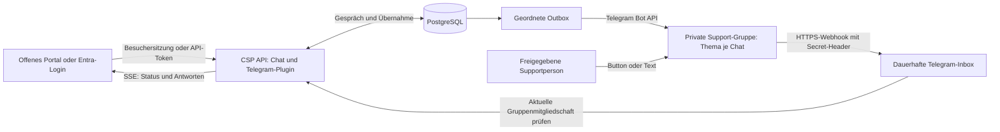

# Telegram-Support im Portal

`@kieksme/csp-plugin-telegram` ist ein eigenständiges Support-Plugin mit derselben Gesprächslogik wie [Slack](slack-support.md) und [Teams](teams-support.md). Es spiegelt Portal-Fragen und abgeschlossene KI-Antworten in eine Telegram-Supergruppe mit aktivierten Themen. Pro Gespräch entsteht ein eigenes Thema. Die reale Telegram-Verbindung ist **noch ungetestet**; automatisierte Tests verwenden synthetische API-Antworten.

## Ablauf und Architektur

**Übernehmen** reserviert den Chat atomar für eine freigegebene Supportperson und unterbricht laufende KI-Ausgabe. Das Portal zeigt den aktuellen Telegram-Profilnamen der Person. Jede neue Textnachricht dieser Person im zugeordneten Thema wird eine Portal-Antwort. Für interne Diskussionen muss die zuständige Person ein anderes Thema verwenden. Andere Personen können im Thema diskutieren, ihre Nachrichten gehen nicht an den Besucher.

**An Bot zurückgeben** erlaubt KI-Antworten auf die nächste Portal-Frage. **Abschließen** beendet das Gespräch. Beide Aktionen darf ausschließlich die zuständige Supportperson ausführen; es gibt keinen automatischen Wechsel. Bot-Nachrichten, weitergeleitete Nachrichten, anonyme Administrator-Nachrichten, Bearbeitungen, Medien und unbekannte Themen werden ignoriert. Supporttexte dürfen 1–4000 Zeichen enthalten. Längere KI-Antworten werden als mehrere einfache Textnachrichten ohne Markdown/HTML und ohne Linkvorschau gesendet.



## Installation und Bot

Nach Veröffentlichung des Pakets im Kundenrepository:

```sh
pnpm dlx @kieksme/csp-cli plugin add @kieksme/csp-plugin-telegram
```

Das Chat-Plugin muss installiert sein. `chatSupport` erlaubt genau einen Supporttransport. Für einen Wechsel von Slack oder Teams eine neue Support-Datenbank verwenden; alte Gespräche über die bisherige Instanz abschließen. Kein bestehendes Gespräch wird nach Telegram migriert.

1. Bei [BotFather](https://t.me/BotFather) einen Bot mit Anzeigenamen **Support** erstellen. Der eindeutige Benutzername muss mit `bot` enden. Token ausschließlich als Runtime-Secret hinterlegen.
2. Eine private Telegram-Supergruppe erstellen und **Themen** aktivieren. Ein reiner Broadcast-Channel erlaubt diesen Dialog nicht. Den Bot als Administrator hinzufügen und **Themen verwalten** erlauben. Der Bot benötigt Administratorstatus für aktuelle Mitgliedschaftsabfragen und liest als Administrator die Gruppen-Nachrichten. Deshalb eine eigene Support-Gruppe verwenden.
3. Numerische Gruppen-ID (negativ, `-100…`) und Telegram-Nutzer-IDs der erlaubten Supportpersonen konfigurieren. Benutzernamen und Anzeigenamen sind keine Berechtigungs-IDs. Die API prüft beim Start Bot-Identität, Forum-Gruppe und Themenrechte; jede Aktion und Antwort prüft erneut die Freigabeliste und aktuelle Gruppenmitgliedschaft.
4. Eine eigene PostgreSQL-Datenbank und genau ein API-Replikat verwenden. Runtime mit `templates/customer/.env.telegram.example` konfigurieren. Frontend und API mit demselben Profil bauen.
5. Den HTTPS-Webhook über Telegram `setWebhook` registrieren: `url` ist `https://<API-HOST>/api/telegram/webhook`, `secret_token` entspricht `CSP_TELEGRAM_WEBHOOK_SECRET`, `allowed_updates` enthält ausschließlich `message` und `callback_query`, `max_connections` ist **1** für geordnete Zustellung. Die Registrierung erfolgt einmalig durch den Betreiber, nicht automatisch beim API-Start. Token im Request-URL und Webhook-Secret nicht in Shell-History, Logs oder Screenshots ausgeben. Mit `getWebhookInfo` Zustellfehler prüfen.
6. Im echten Telegram-Thema einen vollständigen Portal-Test durchführen: Nutzerfrage, KI-Antwort, Übernahme während Generierung, Supportantwort, Rückgabe und Abschluss. Zusätzlich unberechtigte Person, doppelte Updates, unabhängige Besuchersitzung und API-Neustart prüfen.

Offenes Portal ohne Microsoft-Anmeldung:

```json
"chatSupport": { "mode": "telegram", "auth": "anonymous" }
```

Dazu `CSP_TELEGRAM_AUTH=anonymous` und einen stabilen `CSP_CHAT_SESSION_SECRET` mit 64 Hexzeichen setzen. Es gelten dieselben 24-Stunden-Besuchersitzungen, Zugriffstrennung und IP-Grenzen wie bei [Slack ohne Login](slack-support.md#offene-webseite-ohne-login). Besuchernamen sind Pseudonyme. Hinter einem vertrauenswürdigen Proxy `CSP_TRUST_PROXY=true` setzen; direkte öffentliche API-Ports vermeiden.

Für verifizierte Portal-Nutzer `CSP_TELEGRAM_AUTH=entra` (Standard) sowie die [Entra-Konfiguration](teams-support.md#installation-und-entra) verwenden. Öffentliches Profil: `mode: "telegram"`, `auth: "msal"` oder `"session"`, `tenantId`, `clientId` und `scope`. Entra identifiziert Portal-Nutzer; Supportrechte folgen unabhängig davon Telegram.

## Betrieb, Zustellung und Aufbewahrung

Die API bestätigt Webhooks erst nach Speicherung in `csp_telegram_inbox`. Eindeutige `update_id`-Belege überleben API-Neustarts und verhindern doppelte Übernahmen und Antworten. Telegram-Ausfälle werden mit begrenztem exponentiellem Backoff erneut versucht; Rate-Limits berücksichtigen `retry_after`. Übernahmen und Antworten eines Gesprächs werden in Empfangsreihenfolge verarbeitet. Callback-Bestätigungen sind bestmöglich: Nach langen Ausfällen kann der Button-Hinweis abgelaufen sein, die gespeicherte Aktion wird dennoch verarbeitet.

Ausgehende Zustellung ist **mindestens einmal**, nicht exakt einmal: Telegram bietet für `sendMessage` und `createForumTopic` keinen Idempotenzschlüssel. Bei einem Verbindungsabbruch nach Telegram-Annahme oder einem Absturz vor lokaler Speicherung kann eine Nachricht oder ein Thema doppelt entstehen. Ein bereits gespeichertes Thema wird bei einem Karten-Retry wiederverwendet. Mehrteilige Antworten können bei Teilfehlern erneut gesendet werden.

Nach `CSP_CHAT_RETENTION_DAYS` (Standard 30) löscht die API Gespräche, Outbox und zugehörige Inbox-Belege aus PostgreSQL. Bereits gesendete Telegram-Themen und Nachrichten werden **nicht** gelöscht. Gruppenadministratoren müssen deren Aufbewahrung separat regeln. Abschluss entfernt die Buttons, löscht das Thema aber nicht. Bestehende Runtime-Lease schützt die Datenbank vor zwei API-Instanzen; Rollouts brauchen einen kontrollierten Stop/Start mit möglicher kurzer Unterbrechung.

## Demo

`CSP_DEMO=true`, `CSP_TELEGRAM_DEMO=true`, `CSP_TELEGRAM_ENABLED=false` und Profil `chatSupport.mode: "demo"` aktivieren synthetische Übernahme über die gemeinsame Demo-UI. Bot, Telegram und PostgreSQL werden dabei nicht angesprochen. Demo-Erfolg ist keine reale Telegram-Abnahme.

Referenz: [Telegram Bot API](https://core.telegram.org/bots/api) zu `setWebhook`, `getChatMember`, `createForumTopic`, `sendMessage`, `editMessageText` und `answerCallbackQuery`.
